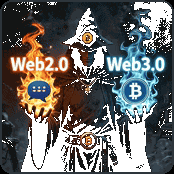

# 👋 Hi, I'm **Web2and3** | 👨‍💻 Open to work

### 🚀 AI • Blockchain • Web3 • Full-Stack Developer

&nbsp;

---

### 🚀 About Me

I'm a passionate developer who loves turning ideas into real, high-impact digital products.
I work across **blockchain, full-stack development, automation, and mobile apps** — always focused on clean architecture, performance, and real-world results.

When I'm not coding, I'm exploring new tech, contributing to open-source, or sharing knowledge with other developers.

  

---

---

### 🎉 Support My Work

**Crypto Donations:**

* **BEP20 / ERC20 (USDT/USDC/ETH/BSC)** — `0xE06a3E9999058A36542Bd484fDB40d8Ac8F9F8fB`
* **TRC20** — `TAP7xTsDeyUXXZ9grgwEbriqHXzYg4qZiJ`
* **SOL** — `55JwWYu6XrNhw24oFH1Fj2RERY1KsYnN8Pa9iHUaEdBd`
* **BTC** — `1jLq8JUDKMsTPdnyHPqXquezo2WT7zEX4`

---

### ☎️ Connect With Me

 

&nbsp;

&nbsp;

&nbsp;

&nbsp;

